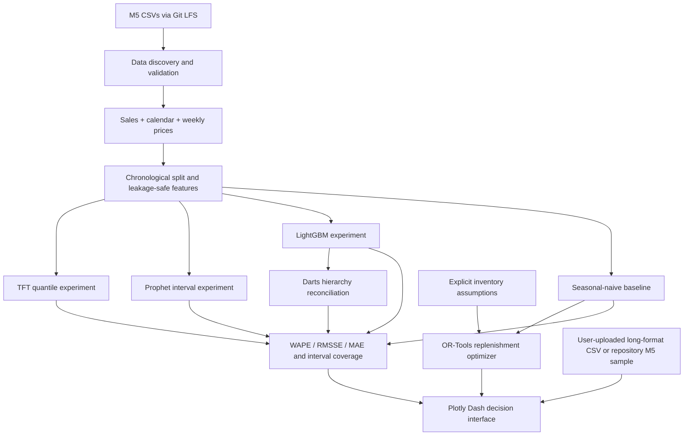

# Architecture and Design Decisions

## Architecture diagram

## End-to-end flow

1. **Ingestion and validation** — read local M5 sales, calendar, and sell-price tables; validate expected files, keys, date coverage, and joins.
2. **Model-ready dataset** — transform wide daily sales into date-indexed series and join calendar/price features at the correct grain. Keep raw files immutable.
3. **Temporal validation** — define chronological train/validation/test cutoffs; all lags and rolling features use past observations only.
4. **Forecast candidates** — seasonal-naive baseline, Prophet baseline, LightGBM global model, and a bounded Temporal Fusion Transformer experiment.
5. **Evaluation and uncertainty** — calculate WAPE/RMSSE by item-store and aggregate level; assess prediction-interval coverage and width.
6. **Hierarchy reconciliation** — use Darts for reconciliation experiments and verify that child forecasts sum to parent totals within numerical tolerance.
7. **Inventory optimization** — OR-Tools converts the selected forecast into an order quantity using lead time, review period, on-hand stock, order limits, and explicit holding/shortage costs.
8. **Decision interface** — Plotly Dash presents the seasonal-naive forecast, holdout WAPE/RMSSE/MAE, CSV export, and replenishment recommendations. Advanced forecast bands and model comparison remain planned dashboard work.

## Logical components

- `demand_inventory.data`: dataset paths and data integrity checks.
- `demand_inventory.metrics`: evaluation metrics.
- Implemented experiment modules: seasonal-naive/LightGBM (`demand_inventory.forecasting`), Prophet with intervals (`demand_inventory.prophet_model`), TFT (`demand_inventory.tft_model`), and Darts MinT plus bottom-up aggregation (`demand_inventory.hierarchy`). Model training remains an explicit local experiment; results must be generated before any model is described as validated.
- `demand_inventory.inventory`: OR-Tools integer order decision with explicit holding/shortage costs, lead time, review period, order multiple, and order cap.
- `app.py`: interactive Dash baseline forecast, chronological holdout metrics, CSV download, repository M5 sample loading when LFS objects are available, and OR-Tools replenishment controls. Advanced model selection, forecast-band visualization, and hierarchy exploration are not yet wired into the dashboard.

## Core design principles

- Keep data preparation, modeling, optimization, and UI separate.
- Make cutoffs, horizons, model settings, and inventory assumptions configurable.
- Never fit preprocessing or use future observations before the forecast origin.
- Preserve a baseline and compare every more complex model against it.
- Persist experiment configuration and results so reported numbers are reproducible.
- Treat unavailable operational values as explicit assumptions—not facts supplied by M5.

## Inventory objective (initial formulation)

Minimize linear holding cost on projected ending inventory plus stockout cost on unmet forecast demand. The current solver uses deterministic demand over the lead-time + review-period window, with integer order quantities, an optional maximum, and an order multiple. It does not yet model purchase cost, supplier capacity, stochastic service levels, or multi-echelon constraints. M5 supplies none of the on-hand/cost/lead-time values; the dashboard inputs are illustrative assumptions.

## Scale strategy

Develop and test on a small, fixed subset first. Run full-hierarchy training and TFT only after measuring memory/runtime. The complete M5 tables are large; generated features, checkpoints, and raw data are excluded from version control.
